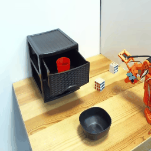
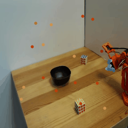
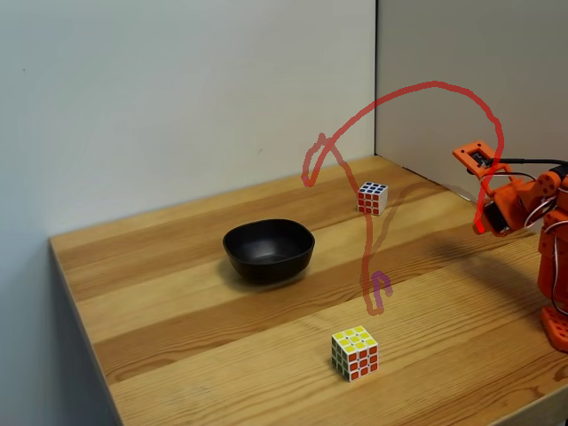

# Open Trajectory

Open Trajectory is a robotics dataset-generation and policy-training codebase for trajectory-conditioned manipulation with LeRobot datasets. The current focus is generating reliable gripper-tip trajectories, rendering trajectory-conditioning images, adding optional depth features, and training/evaluating Diffusion Policy variants on SO-100 style manipulation data.

This README is a working draft. The repository is being curated from research scripts, so each section marks which pieces are current and which still need confirmation.

## Visual Overview

Trajectory tracking and forecasting examples:






Example trajectory overlay:



Planned visual: hand-drawn trajectory sketching video.

## Data Generation

### Global Trajectory Dataset

Current recommended script:

```bash
python data_generation/generate_global_trajectory_dataset.py \
  --source-repo-id <source_dataset> \
  --output-repo-id <output_dataset> \
  --camera-key observation.images.side \
  --resume
```

This script generates global trajectories with YOLO gripper-tip seeding plus TAPNext++ tracking. This strategy has proven more reliable for actually following the gripper tip.

Output feature:

```text
observation.global_trajectory
```

Important behavior:

- samples gripper-tip points from a YOLO mask;
- tracks those points with TAPNext++;
- computes a median tip trajectory;
- detects grasp/release events from the action signal;
- can preserve an existing trajectory length or write a new max-length feature;
- supports manual redraw of selected episodes through `--redraw-episodes`.

Required external artifacts:

```text
models/segmentso101.pt
models/tapnextpp_ckpt.pt
```

You can also pass explicit paths with:

```bash
--yolo-path /path/to/segmentso101.pt
--tapnext-checkpoint /path/to/tapnextpp_ckpt.pt
```

### RT-Trajectory Image Dataset

Current recommended script:

```bash
python data_generation/generate_trajectory_image_dataset.py \
  --source-repo-id <source_dataset> \
  --output-repo-id <output_dataset>-rt-trajectory-images \
  --camera-key observation.images.side \
  --resume
```

This generates one rendered trajectory image per episode and adds it as an image feature. This is the direct replication path for the RT-Trajectory-style prior-work conditioning format.

Output feature:

```text
observation.images.rt_trajectory
```

This script does not add point tracks or `observation.global_trajectory`. TAPNext++ is only used internally to render the trajectory image.

RT-Trajectory image semantics:

- black background;
- red trajectory path, with intensity encoding time/progress;
- green marker for grasp;
- blue marker for release;
- trajectory is truncated at release, excluding return-to-start motion.

### Depth Features

Current candidate script:

```bash
python data_generation/add_depth_features.py \
  --source-repo-id <source_dataset> \
  --output-repo-id <output_dataset>-depth \
  --camera-keys auto \
  --depth-anything-dir /path/to/Depth-Anything-V2
```

This adds Depth Anything V2 Small depth-video features for one or more RGB camera streams.

Output features follow:

```text
observation.depth.<camera_suffix>
```

Status note: defaults and exact camera choices still need confirmation.

### Dataset Trimming

There are two trimming scripts, with different goals:

```text
data_generation/trim_dataset_idle_ends.py
data_generation/trim_dataset_after_action_release.py
```

`trim_dataset_idle_ends.py` removes stationary prefixes and suffixes from each episode. It uses action/state motion thresholds and keeps configurable context before the first active region and after the last active region. It is useful for removing dead time at episode boundaries while preserving interior pauses.

`trim_dataset_after_action_release.py` focuses on episode tails after the final grasp/release action bump. It detects action peaks and keeps frames through the release/post-release window. It is more specific to manipulation episodes where the final release event defines the useful end of the rollout.

Release trimming is included as an optional post-processing step in the main dataset-generation scripts:

```bash
--trim-after-action-release
--trim-output-repo-id <trimmed_dataset>
--trim-keep-after-frames 0
--trim-event-threshold 0.25
```

This preprocessing is important for policy learning. Removing no-action tails means training sees mostly active observations where the task still needs to be completed. This is especially useful for Diffusion Policy training: if the final pose looks similar to the start pose, untrimmed demonstrations can teach the policy that both "do nothing at the beginning" and "do nothing after completion" are valid near-identical visual states. That ambiguity can make a policy stay at the start pose and never begin the task.

Recommended default: use release trimming for manipulation-policy training datasets. Use idle-boundary trimming when the dataset also has long stationary prefixes before the task starts.

### Point-Track Generation

Current recommended combined script:

```bash
python data_generation/generate_tracks_and_trajectory_dataset.py \
  --source-repo-id <source_dataset> \
  --output-repo-id <output_dataset> \
  --main-cam-key observation.images.side \
  --features both \
  --resume
```

This is the preferred entry point when a dataset should contain both:

```text
observation.global_trajectory
observation.main_cam_point_tracks
observation.sec_cam_point_tracks
```

The point tracks come from the older TAPNext++ Track Transformer feature generator, while `observation.global_trajectory` comes from the newer gripper-tip tracking strategy. The body/gripper median trajectory computed internally by the track generator is intentionally ignored when `--features both` is used.

Feature modes:

```bash
--features both        # gripper-tip global trajectory + point tracks
--features tracks      # point tracks only
--features trajectory  # gripper-tip global trajectory only
```

Lower-level track-only script:

```bash
python data_generation/generate_track_dataset.py \
  --source-repo-id <source_dataset> \
  --output-repo-id <output_dataset>-tracks \
  --main-cam-key observation.images.side \
  --no-global-trajectory
```

Track feature semantics:

- `observation.main_cam_point_tracks`: first half robot-seed tracks, second half fresh per-timestep grid tracks;
- `observation.sec_cam_point_tracks`: optional secondary-camera grid tracks;
- all track coordinates are normalized to `[0, 1]`;
- each row contains current point position plus `H` future positions.

Current caveat: the combined script adds new features to datasets that do not already contain those output feature names. Use `generate_global_trajectory_dataset.py` when the goal is specifically to replace an existing `observation.global_trajectory`.

## Model Training

### Sequence-Conditioned Diffusion Policy

Main script:

```bash
python training/train_sequence_diffusion.py \
  --repo-id <dataset_with_observation.global_trajectory> \
  --denoiser-backbone dit \
  --num-steps 100000
```

This is the main trajectory-sequence conditioned trainer. It consumes `observation.global_trajectory` and can also use camera, DINO, depth, state, and track features depending on the dataset and flags.

The same script supports both action denoiser backbones:

```bash
--denoiser-backbone dit
--denoiser-backbone unet
```

The DiT implementation lives in:

```text
training/diffusion_transformer.py
```

Useful depth option:

```bash
--use-depth
```

Depth features are auto-detected from the configured visual camera keys using `observation.depth.<camera_suffix>`.

### RT-Trajectory Image Diffusion Policy

Main baseline script:

```bash
python training/train_trajectory_image_diffusion.py \
  --dataset-repo-id <dataset_with_observation.images.rt_trajectory> \
  --dry-run
```

This trains a Diffusion Policy that uses camera conditioning plus an encoded RT-Trajectory image. It is intended as an image-conditioned comparison against sequence-based trajectory conditioning.

Depth conditioning is available in this trainer. Use depth datasets produced by `data_generation/add_depth_features.py`, then enable:

```bash
--use-depth
--depth-prefix observation.depth
```

or pass a specific depth feature:

```bash
--use-depth --depth-key observation.depth.side
```

Specialist/no-trajectory policy scripts are intentionally not included in this curated repo for now.

## Inference

Status: not yet included for the current public training paths.

There are currently no curated inference scripts for:

- DiT sequence-conditioned checkpoints;
- RT-Trajectory image-conditioned checkpoints.

This is important because these checkpoints are not plain self-contained LeRobot policies. The inference loader must reconstruct the same external encoders and, for DiT checkpoints, the same local denoiser backbone before loading weights.

## Setup

Expected environment:

```bash
conda activate lerobotclone
```

Core dependencies:

- LeRobot;
- PyTorch;
- TAPNext++ / tapnet;
- Ultralytics YOLO;
- OpenCV;
- Hugging Face Hub access for LeRobot datasets;
- optional Depth Anything V2 for depth-feature generation.

Model files are intentionally not tracked by git. Place local weights in `models/` or pass explicit paths to the scripts.

## Repository Status

This repository is being curated as a standalone public research codebase. Interfaces and defaults marked as provisional still require confirmation before a release.
