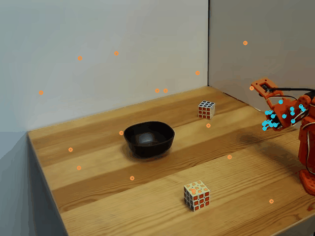
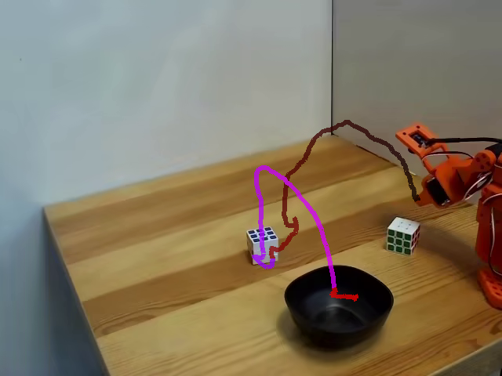
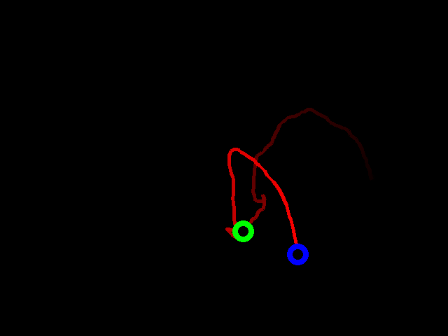

# Open Trajectory

Open Trajectory is a robotics dataset-generation and policy-training codebase for trajectory-conditioned manipulation with LeRobot datasets. It builds point-track, gripper-tip trajectory, rendered trajectory-image, and optional depth representations, then trains policies that condition on those representations.

## Representations at a Glance

Point tracks are a compact, increasingly common robotics representation: instead of asking a policy to recover all motion directly from pixels, they expose how selected robot and scene points move now and over a short future horizon. Open Trajectory can generate point tracks independently or together with a task-level gripper-tip trajectory.

| Representation | What it captures | Per-frame or per-episode form |
|---|---|---|
| Point tracks | Sparse robot/object motion from one or more camera views | Normalized `[query, current+future horizon, xy]` tracks per frame |
| Gripper-tip trajectory | The task-level end-effector path and grasp/release interval | Normalized `[trajectory step, x, y, active]` sequence per episode |
| RT-Trajectory image | The same task-level path rendered as an image-conditioning baseline | RGB image with time-varying red path and grasp/release markers |
| Depth | Optional scene geometry aligned with an RGB stream | Depth image or video feature for each configured camera view |

The point-track generator supports:

- robot-seeded tracks that follow the manipulator across the episode;
- fresh grid tracks that capture local scene and object motion at each timestep;
- an optional additional camera view;
- configurable forecast horizon and sampling stride;
- combined generation of point tracks and the gripper-tip trajectory in one dataset pass.

### Camera roles and dataset keys

Open Trajectory does not require cameras to have names such as `side`, `wrist`, or `main`. Commands accept the actual feature keys stored in each LeRobot dataset.

- **Main-view camera** means the primary external view of the robot and workspace. A dataset might call it `observation.images.side`, `observation.images.front`, or something else.
- **Wrist-view camera** means an egocentric camera attached near the end effector. Its key is also dataset-specific.
- **Additional camera** means any other view used for environment encoding or secondary point tracks.

Examples below use placeholders such as `<main_view_camera_key>`. Replace them with keys from the target dataset's feature metadata. Names such as `observation.main_cam_point_tracks` are generated output-feature names; they do not require the input camera itself to be named `main` or `side`.

## Visual Overview

Point-track example:



Gripper-tip trajectory example:


Sequence-based representation visualization



RT-Trajectory image replication (calibration free)



 Additional depth feature (DepthAnything V2-small):


## Native LeRobot Plugin

The v0.1 package provides one LeRobot policy type, `open_trajectory`, with two conditioning modes:

- `sequence` consumes `observation.global_trajectory` as normalized XY plus the grasp/release active interval;
- `rt_image` consumes `observation.images.rt_trajectory` as the rendered RT-Trajectory image baseline.

Both modes share camera/state/depth fusion and support DiT or U-Net action denoisers. DiT is the default and the configured comparison path.

Use Python 3.12 and LeRobot `>=0.6.2,<0.7`, then install the plugin from the repository root:

```bash
python -m pip install -e .
```

LeRobot discovers installed distributions whose names begin with `lerobot_policy_`; no LeRobot source edit is required. The package also installs the `open-trajectory` dataset/visual command.

### Command-Line Interface

These paths are package-native:

- `lerobot-train` policy/config/processor discovery and checkpoint handling;
- `open-trajectory dataset augment` for adding validated artifact-backed features;
- `open-trajectory visuals render` for rendering an episode artifact.

The following commands remain transitional source-checkout adapters in v0.1:

- `open-trajectory dataset generate`;
- `open-trajectory dataset trim`;
- `open-trajectory dataset add-depth`.

Run those three commands from the repository root. They dispatch to the retained scripts under `data_generation/` and fail explicitly when those scripts are unavailable, such as from a wheel installed without a source checkout. The retained scripts in the sections below remain the canonical generation, trimming, and depth implementations until they are migrated into package-native libraries.

## Data Generation

### Global Trajectory Dataset

Current recommended script:

```bash
python data_generation/generate_global_trajectory_dataset.py \
  --source-repo-id <source_dataset> \
  --output-repo-id <output_dataset> \
  --camera-key <main_view_camera_key> \
  --resume
```

This script generates global trajectories with YOLO gripper-tip seeding plus TAPNext++ tracking. This strategy has proven more reliable for actually following the gripper tip.

Output feature:

```text
observation.global_trajectory
```

Important behavior:

- samples gripper-tip points from a YOLO mask;
- tracks those points with TAPNext++;
- computes a median tip trajectory;
- detects grasp/release events from the action signal;
- can preserve an existing trajectory length or write a new max-length feature;
- supports manual redraw of selected episodes through `--redraw-episodes`.

Required external artifacts:

```text
models/segmentso101.pt
models/tapnextpp_ckpt.pt
```

You can also pass explicit paths with:

```bash
--yolo-path /path/to/segmentso101.pt
--tapnext-checkpoint /path/to/tapnextpp_ckpt.pt
```

### RT-Trajectory Image Dataset

Current recommended script:

```bash
python data_generation/generate_trajectory_image_dataset.py \
  --source-repo-id <source_dataset> \
  --output-repo-id <output_dataset>-rt-trajectory-images \
  --camera-key <main_view_camera_key> \
  --resume
```

This generates one rendered trajectory image per episode and adds it as an image feature. This is the direct replication path for the RT-Trajectory-style prior-work conditioning format.

Output feature:

```text
observation.images.rt_trajectory
```

This script does not add point tracks or `observation.global_trajectory`. TAPNext++ is only used internally to render the trajectory image.

RT-Trajectory image semantics:

- black background;
- red trajectory path, with intensity encoding time/progress;
- green marker for grasp;
- blue marker for release;
- trajectory is truncated at release, excluding return-to-start motion.

### Depth Features

Current candidate script:

```bash
python data_generation/add_depth_features.py \
  --source-repo-id <source_dataset> \
  --output-repo-id <output_dataset>-depth \
  --camera-keys auto \
  --depth-anything-dir /path/to/Depth-Anything-V2
```

This adds Depth Anything V2 Small depth-video features for one or more RGB camera streams. The visual overview shows an example `observation.depth.side` episode.

Output features follow:

```text
observation.depth.<camera_suffix>
```

### Dataset Trimming

There are two trimming scripts, with different goals:

```text
data_generation/trim_dataset_idle_ends.py
data_generation/trim_dataset_after_action_release.py
```

`trim_dataset_idle_ends.py` removes stationary prefixes and suffixes from each episode. It uses action/state motion thresholds and keeps configurable context before the first active region and after the last active region. It is useful for removing dead time at episode boundaries while preserving interior pauses.

`trim_dataset_after_action_release.py` focuses on episode tails after the final grasp/release action bump. It detects action peaks and keeps frames through the release/post-release window. It is more specific to manipulation episodes where the final release event defines the useful end of the rollout.

Release trimming is included as an optional post-processing step in the main dataset-generation scripts:

```bash
--trim-after-action-release
--trim-output-repo-id <trimmed_dataset>
--trim-keep-after-frames 0
--trim-event-threshold 0.25
```

This preprocessing is important for policy learning. Removing no-action tails means training sees mostly active observations where the task still needs to be completed. This is especially useful for Diffusion Policy training: if the final pose looks similar to the start pose, untrimmed demonstrations can teach the policy that both "do nothing at the beginning" and "do nothing after completion" are valid near-identical visual states. That ambiguity can make a policy stay at the start pose and never begin the task.

Recommended default: use release trimming for manipulation-policy training datasets. Use idle-boundary trimming when the dataset also has long stationary prefixes before the task starts.

### Point-Track Generation

Current recommended combined script:

```bash
python data_generation/generate_tracks_and_trajectory_dataset.py \
  --source-repo-id <source_dataset> \
  --output-repo-id <output_dataset> \
  --main-cam-key <main_view_camera_key> \
  --features both \
  --resume
```

This is the preferred entry point when a dataset should contain both point-based motion features and the task-level gripper-tip trajectory:

```text
observation.global_trajectory
observation.main_cam_point_tracks
observation.sec_cam_point_tracks
```

The point tracks come from the TAPNext++ Track Transformer feature generator, while `observation.global_trajectory` comes from the gripper-tip tracking strategy. The body/gripper median trajectory computed internally by the track generator is intentionally ignored when `--features both` is used.

Feature modes:

```bash
--features both        # gripper-tip global trajectory + point tracks
--features tracks      # point tracks only
--features trajectory  # gripper-tip global trajectory only
```

Lower-level track-only script:

```bash
python data_generation/generate_track_dataset.py \
  --source-repo-id <source_dataset> \
  --output-repo-id <output_dataset>-tracks \
  --main-cam-key <main_view_camera_key> \
  --no-global-trajectory
```

Track feature semantics—the words `main_cam` and `sec_cam` describe output roles, not required input-camera names:

- `observation.main_cam_point_tracks`: robot-seeded tracks plus fresh per-timestep grid tracks from the selected main-view camera;
- `observation.sec_cam_point_tracks`: optional grid tracks from the selected additional camera;
- all track coordinates are normalized to `[0, 1]`;
- each row contains current point position plus `H` future positions.

The combined script adds new features to datasets that do not already contain those output feature names. Use `generate_global_trajectory_dataset.py` when the goal is specifically to replace an existing `observation.global_trajectory`.

## Model Training

### Native `lerobot-train` examples

The example configs disable Hub uploads and Weights & Biases by default. Override the placeholder dataset ID and choose a new output directory for each run:

```bash
lerobot-train \
  --config_path=configs/train_sequence_dit.yaml \
  --dataset.repo_id=YOUR_NAMESPACE/trajectory_sequence_dataset \
  --output_dir=outputs/open_trajectory/sequence_dit_run
```

```bash
lerobot-train \
  --config_path=configs/train_rt_image_dit.yaml \
  --dataset.repo_id=YOUR_NAMESPACE/rt_image_dataset \
  --output_dir=outputs/open_trajectory/rt_image_dit_run
```

The sequence dataset must contain `observation.global_trajectory` with shape `[T, 3]`. The RT-image dataset must contain `observation.images.rt_trajectory`. The example YAML files map the main-view and wrist-view roles to `observation.images.side` and `observation.images.wrist` only as illustrations. Replace `policy.environment_image_keys` with the RGB keys present in the target dataset. LeRobot infers input/output feature shapes and dataset statistics before constructing the policy.

These are full 100,000-step training templates, not smoke tests. For a local configuration check, override `--steps=1`, `--batch_size=1`, `--num_workers=0`, `--save_checkpoint=false`, and use an explicit disposable output directory. A one-step pass checks integration only; it does not establish training quality or deployability.

### Retained sequence-conditioned research trainer

Main script:

```bash
python training/train_sequence_diffusion.py \
  --repo-id <dataset_with_observation.global_trajectory> \
  --denoiser-backbone dit \
  --num-steps 100000
```

This is the main trajectory-sequence conditioned trainer. It consumes `observation.global_trajectory` and can also use camera, DINO, depth, state, and track features depending on the dataset and flags.

The same script supports both action denoiser backbones:

```bash
--denoiser-backbone dit
--denoiser-backbone unet
```

The DiT implementation lives in:

```text
training/diffusion_transformer.py
```

Useful depth option:

```bash
--use-depth
```

Depth features are auto-detected from the configured visual camera keys using `observation.depth.<camera_suffix>`.

### Retained RT-Trajectory image research trainer

Main baseline script:

```bash
python training/train_trajectory_image_diffusion.py \
  --dataset-repo-id <dataset_with_observation.images.rt_trajectory> \
  --dry-run
```

This trains a Diffusion Policy that uses camera conditioning plus an encoded RT-Trajectory image. It is intended as an image-conditioned comparison against sequence-based trajectory conditioning.

Depth conditioning is available in this trainer. Use depth datasets produced by `data_generation/add_depth_features.py`, then enable:

```bash
--use-depth
--depth-prefix observation.depth
```

or pass a specific depth feature:

```bash
--use-depth --depth-key observation.depth.side
```

Specialist/no-trajectory policy scripts are not included.

## Inference

Native checkpoint serialization is covered, but robot rollout commands have not been validated.

The native plugin saves its configuration and model state through LeRobot's standard checkpoint path. Loading still requires the `lerobot_policy_open_trajectory` distribution so LeRobot can discover the policy class and reconstruct the configured encoders and denoiser.

There are currently no deployment commands for:

- DiT sequence-conditioned checkpoints;
- RT-Trajectory image-conditioned checkpoints.

The retained research-script checkpoints are not interchangeable with native plugin checkpoints. Their loaders must reconstruct the matching external encoders and, for DiT checkpoints, the matching local denoiser before loading weights.

## Setup

Core dependencies:

- LeRobot;
- PyTorch;
- TAPNext++ / tapnet;
- Ultralytics YOLO;
- OpenCV;
- Hugging Face Hub access for LeRobot datasets;
- optional Depth Anything V2 for depth-feature generation.

Model files are intentionally not tracked by git. Place local weights in `models/` or pass explicit paths to the scripts.


## References

@misc{gu2023rttrajectoryrobotictaskgeneralization,
      title={RT-Trajectory: Robotic Task Generalization via Hindsight Trajectory Sketches}, 
      author={Jiayuan Gu and Sean Kirmani and Paul Wohlhart and Yao Lu and Montserrat Gonzalez Arenas and Kanishka Rao and Wenhao Yu and Chuyuan Fu and Keerthana Gopalakrishnan and Zhuo Xu and Priya Sundaresan and Peng Xu and Hao Su and Karol Hausman and Chelsea Finn and Quan Vuong and Ted Xiao},
      year={2023},
      eprint={2311.01977},
      archivePrefix={arXiv},
      primaryClass={cs.RO},
      url={https://arxiv.org/abs/2311.01977}, 
}

@misc{jung2026tapnextwhatstrackingpoint,
      title={TAPNext++: What's Next for Tracking Any Point (TAP)?}, 
      author={Sebastian Jung and Artem Zholus and Martin Sundermeyer and Carl Doersch and Ross Goroshin and David Joseph Tan and Sarath Chandar and Rudolph Triebel and Federico Tombari},
      year={2026},
      eprint={2604.10582},
      archivePrefix={arXiv},
      primaryClass={cs.CV},
      url={https://arxiv.org/abs/2604.10582}, 
}

https://huggingface.co/riversnow/so101-segmentation-model
